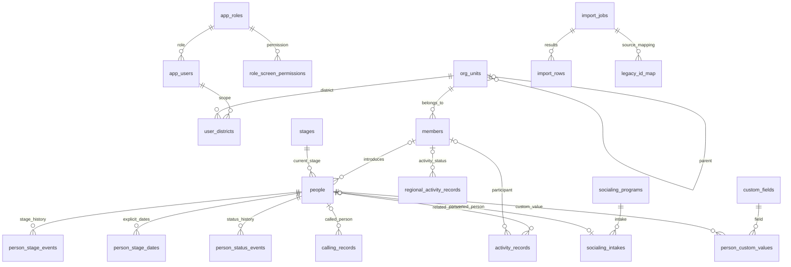

# SMOA 기본 테이블 설계안

작성일: 2026-11-26 KST. 대상: SMOA 4.0.41 → 웹 SMOA / MariaDB 10.11.
상태: 사용자가 테이블을 직접 설계하기로 하여 이 초안의 작업은 중단했다. 참고용으로만 보존하며 확정 설계가 아니다. 생성된 db/schema-draft.sql도 Codex 검토·DB 적용을 하지 않았다. 운영 DB 적용·실제 자료 이관·DB 쓰기 테스트는 하지 않았다.

## 1. 설계 기준

- 로그인 계정(app_users), 활동자 명부(members), 대상자(people)를 구분한다. 세 이름이 같아도 같은 레코드로 취급하지 않는다.
- 구역·지역·하위 조직은 org_units의 상하위 관계로 관리한다. 기존 반은 공통코드 값이므로 무조건 독립 조직으로 변환하지 않는다.
- 화면마다 테이블을 만들지 않는다. 구역별·개인별·반별 통계, 연결률, 8주 그래프는 같은 원본 기록에서 계산한다.
- 기존 자료실 생성·전환·공유 기능은 웹 범위에서 제외한다. 이관 출처를 식별하는 source_namespace는 남기되 자료실 관리 기능을 새로 만들지 않는다.
- 과거 기록의 구역·반·이름·직업·인도자 표기를 스냅샷으로 보존한다. 현재 명부를 수정해도 과거 실적이 임의로 이동하지 않게 한다.
- 날짜·시간 미입력은 NULL로 저장한다. 0시나 오늘 날짜를 임의로 채우지 않는다. 업무 날짜/시각은 한국 기준 DATE/TIME/DATETIME, 시스템 생성·변경 시각은 UTC DATETIME(3)로 구분한다.
- 본문 검색은 utf8mb4_general_ci. 테이블명은 소문자 snake_case. 사용자가 요구한 테이블명 대소문자 무시는 서버 lower_case_table_names=1이 별도로 필요하다. 마지막 확인값은 0이므로 스키마 실행 전에 설정 변경·검증이 남아 있다.
- 내부 ID와 참조는 정확히 연결되어야 한다. 내부 ID는 VARCHAR(80) CHARACTER SET ascii COLLATE ascii_bin을 기본으로 하고, 사용자 표시명과 검색값에만 ci 비교를 적용한다. 기존 단계 ID에는 한글이 있으므로 새 stage ID와 원본 ID 매핑을 사용한다.
- PK는 앱에서 생성하는 UUID 문자열을 기본으로 하되 기존 유효 ID도 보존 가능하다. 출처 간 충돌은 legacy_id_map으로 명시적으로 변환한다. ID를 소문자로 일괄 변환하지 않는다.
- InnoDB, 명시적 FK와 인덱스를 사용한다. 이력·실적을 연쇄 삭제하지 않는다. 원본 행 삭제 시 연결을 해제하더라도 스냅샷은 남긴다. 조직과 단계는 사용 중지 우선이다.
- 목록 검색의 대소문자 비교와 별개로 코드 키·가져오기 중복 판정은 기존 NFKC/공백 정규화 규칙을 검토한다. ci 설정만으로 기존 앱의 정규화를 모두 대신하지 않는다.

## 2. 테이블 목록과 주요 컬럼

아래 컬럼은 물리 스키마 초안 작성 기준이다. PK는 기본키, FK는 참조키다. 설명에 별도로 적은 것 외에 업무 테이블은 created_at, updated_at을 가진다. 모든 *_id 참조의 길이·문자셋·collation은 부모 키와 일치시킨다.

### 조직·계정·권한

| 테이블 | 목적 | 주요 컬럼과 관계 |
|---|---|---|
| app_roles | 관리자·담당자·열람자 역할 | id PK, name, is_system |
| app_users | 웹 로그인 사용자 | id PK, username UNIQUE(ci), display_name, password_hash(정확 비교), role_id FK, member_id nullable FK, active, is_root_admin, password_changed_at |
| user_districts | 사용자에게 허용한 구역 | user_id + district_id 복합 PK/FK → app_users/org_units. 앱에서 해당 조직이 구역인지 검증 |
| role_screen_permissions | 역할별 화면 권한 | role_id + screen_key 복합 PK, can_access/can_read/can_write/can_export. access 꺼짐 → 전부 꺼짐, read 꺼짐 → write/export 꺼짐 |
| org_units | 지역·구역 등 조직 트리 | id PK, code UNIQUE, name, unit_type, parent_id nullable 자기 FK, leader_member_id nullable FK, leader_title, report_region nullable UNIQUE, active. 책임자 참조는 members 생성 후 추가 |
| members | 활동자·인도자 명부 | id PK, code UNIQUE, name, unit_id FK, position_text, class_name, employment_text, status(active/inactive), notes |

org_units의 순환, 최대 깊이 12, 활성 부모와 책임자의 소속 적합성은 현재 앱의 조직 검증을 유지한다. app_users의 member_id는 선택 연결이며, 모든 활동자에게 로그인 계정을 강제하지 않는다.

### 코드·설정

| 테이블 | 목적 | 주요 컬럼과 관계 |
|---|---|---|
| stages | 단계 사전 | id PK, stage_key UNIQUE(정확 비교), name, sort_order, active. 고정 ENUM 사용 안 함 |
| code_groups | 공통코드 그룹 | id PK, group_key UNIQUE(정확 비교), label, is_system, active |
| code_items | 반·직업·직책·활동종류·장소 등의 선택값 | id PK, group_id FK, value, label, aliases_json, sort_order, active. (group_id,value) UNIQUE는 기존 코드의 정확 비교 보존; ci 조회와 구분 |
| custom_fields | 사용자 정의 대상자 항목 | id PK, label, field_type, code_group_id nullable FK, options_json, sort_order, active |
| person_custom_values | 사용자 항목 값 | person_id + field_id 복합 PK/FK, value_text/value_number/value_date/value_boolean. 필드 유형별 하나만 사용; 미입력은 행 없음 |
| app_settings | 조직 공통 설정 | setting_key PK, value_json, updated_at. 주 시작 요일·일보 열 배치·활동자 순서·제외/이름통합 등. 비밀 값은 넣지 않음 |

코드 비활성화는 과거값을 삭제하지 않는다. 사용자 정의 필드와 옵션의 기존 정확한 키·순서를 보존한다. 스키마만으로 동적 필드 유형과 실제 값의 대응을 모두 강제할 수 없으므로 API에서 검증한다.

### 대상자와 이력

| 테이블 | 목적 | 주요 컬럼과 관계 |
|---|---|---|
| people | 대상자의 현재 상태 | id PK, code UNIQUE(정확 비교), name, gender, age nullable(0~120), age_as_of nullable, classification1/2, found_date nullable, found_time nullable, date_unknown, region_name, district_id nullable FK, class_name, employment_text, introducer_member_id nullable FK, introducer_code/name_snapshot, worker_name, stage_id FK, status(active/dropped), place, tool, residence, teacher_name, reason, appointment_date nullable, notes, row_version |
| person_stage_events | 단계 이동 이력 | id PK, person_id FK, sequence_no, from_stage_id nullable FK, to_stage_id FK, from_name/to_name_snapshot, effective_local DATETIME, time_unknown, baseline, recorded_at UTC, actor_user_id nullable FK, actor_name, reason, region_name, class_name, worker_name, member_id nullable FK, worker_code, employment_text. (person_id,sequence_no) UNIQUE |
| person_stage_dates | 명시적으로 입력한 단계일 | person_id + milestone_key 복합 PK, stage_id nullable FK, reached_date, updated_at. manpikDate/findADate/habBDate/habADate/youngTtaDate/bokshinDate/cardReceivedDate/centerRegisteredDate 보존 |
| person_status_events | 탈락·복귀 이력 | id PK, person_id FK, sequence_no, from_status/to_status, effective_local, recorded_at, actor_user_id nullable FK, actor_name, reason, region_name. (person_id,sequence_no) UNIQUE |

단계일과 단계 이동 이력은 같은 자료가 아니다. 명시 단계일이 없는 경우에만 기존 규칙으로 이력에서 계산한다. 단계 최초 확인·baseline·시간 미상 표시를 보존한다. 영따/따기, 복음방 통합, 신카접수 별칭 등 집계 규칙은 기존 알고리즘을 유지한다.

현재 구역 FK가 연결되지 않는 과거 구역 문자열도 region_name에 저장한다. 이름만 보고 구역·반·인도자 FK를 확정하지 않는다. 대상자에는 전체 연락처 평문 컬럼을 두지 않는다.

### 활동·일보·목표

| 테이블 | 목적 | 주요 컬럼과 관계 |
|---|---|---|
| activity_records | 독립 활동과 대상자별 활동 | id PK, code UNIQUE(정확 비교), person_id nullable FK, activity_date, start_time/end_time nullable, duration_minutes, classification2, session_key nullable, member_id nullable FK, worker_code/name_snapshot, region_name, area_id_snapshot, area_name_snapshot, unit_path_snapshot, class_name, place, activity_kind, notes |
| regional_activity_records | 구성원별 적극/후원/소극/비활동 기록 | id PK, member_id nullable FK, source_namespace, source_member_id(정확 비교), record_month CHAR(7), record_date nullable, period_key(날짜가 있으면 YYYY-MM-DD, 없으면 YYYY-MM), activity_code 1~4, name/member_code/region_name 스냅샷. (source_namespace,source_member_id,period_key) UNIQUE |
| daily_area_reports | 상세 없이 구역 합계만 있는 일계 | id PK, region_name, report_date, found_count/advanced_count/dropped_count. (region_name,report_date) UNIQUE |
| daily_finding_reports | 보고일별 찾기·유지·탈락 상세 | id PK, report_date, person_id nullable FK, person_code_snapshot, name, found_date nullable, date_unknown, found_time nullable, stage_id FK, report_status(신규/유지/탈락), member_id nullable FK, source_member_id, member_code/worker/region/class/unit_path 스냅샷, gender, age nullable, tool, residence, place, classification1/2, teacher_name, reason. (report_date,person_code_snapshot) UNIQUE |
| goals | 구역·반의 기간별 목표 | id PK, region_name(미지정은 빈 문자열), class_name(미지정은 빈 문자열), org_unit_id nullable FK, date_from/date_to, stage_id nullable FK(전체 단계이면 NULL), stage_scope_key(전체는 '*', 아니면 stage id), period_unit(week/month/custom), target_count(0 허용). (region_name,class_name,date_from,date_to,stage_scope_key) UNIQUE |

활동은 person_id가 있으면 대상자 안의 활동, 없으면 독립 활동이다. 둘을 별도 사본으로 중복 저장하지 않는다. workerId가 UUID가 아니라 기존 구성원 code인 경우가 있으므로 worker_code와 member_id를 구분한다. 시간 미입력·자정 넘는 활동·분모·회차 합산은 기존 규칙을 사용한다. 활동 참여 회차를 나타내는 session_key는 그룹 식별자이므로 행 전체 UNIQUE로 만들지 않는다.

지역활동기록의 과거 memberId는 현재 명부에 없을 수 있다. FK는 연결 가능한 경우에만 설정하고 source_member_id와 스냅샷으로 기록을 유지한다. period_key는 NULL을 포함한 UNIQUE가 중복을 허용하는 문제를 피하려고 명시적으로 저장하고 CHECK로 날짜/월과의 대응을 검사한다.

상세 찾기 실적과 구역 일계를 무조건 더하지 않는다. 기존 통계의 상세 우선/일계 보완 정책을 유지해야 한다. 목표의 stage_scope_key는 stage_id와 CHECK로 대응시켜 전체 단계 NULL 중복을 막는다.

### 콜링·소셜링

| 테이블 | 목적 | 주요 컬럼과 관계 |
|---|---|---|
| calling_records | 대상자별 통화 시도 | id PK, person_id nullable FK, person_name/code_snapshot, introducer_name_snapshot, area_name, finding_date nullable, call_date, call_time nullable, caller_name, round_number(0~5), round_name nullable(60자), result(만픽/부재/재통화/거절/기타), original_result nullable, reported_result nullable, notes(최대 5,000자), attempt_key_hash(정확 비교, UNIQUE), source_import_job_id nullable FK |
| socialing_programs | 소셜링 모임 사전 | id PK, name, normalized_name_key UNIQUE(정확 비교), aliases_json, active |
| socialing_intakes | 외부유입과 대상자 전환 연결 | id PK, program_id FK, intake_date nullable, name, region_name, introducer_member_id nullable FK, notes, person_id nullable UNIQUE FK, status(pending/converted), converted_at nullable |

콜링 person_id는 미연결 MIG 자료 때문에 NULL을 허용한다. 이름·인도자·구역 스냅샷으로 조회가 가능해야 한다. 숫자 회차 0~5와 사용자 회차명(예: 수능인원/5차)을 함께 보존한다. 구형 엑셀의 5차→추가회차 해석과 신규 사용자 회차명을 구분한다.

attempt_key_hash는 src/calling.cjs의 attemptKey 규칙을 서버에서 동일하게 만든 뒤 SHA-256으로 계산한다. 특이사항(notes)은 중복 판정에 포함하지 않는다. 미연결→연결 시 기존 매칭 정책에 따라 키를 다시 검증한다. result='기타'의 originalResult 포함 규칙과 reportedResult를 구분한다. 가져오기 중복키를 SQL CONCAT으로 임의 재현하지 않는다.

소셜링은 pending 목록과 person.socialing을 하나의 intake 행의 상태 전환으로 표현한다. 기존 대상자 연결/신규 찾B 생성은 한 트랜잭션으로 처리한다. 기존 연결 프로필에는 유입일이 없을 수 있어 intake_date는 nullable이며 pending은 날짜 필수 CHECK를 둔다.

### 이력·가져오기·이관 추적

| 테이블 | 목적 | 주요 컬럼과 관계 |
|---|---|---|
| audit_logs | 업무 변경 이력 | id PK, chain_key, sequence_no, at_utc, actor_user_id nullable FK, actor_name, action_name, target_type, target_id, before_json/after_json, previous_hash, entry_hash, source_import_job_id nullable FK. (chain_key,sequence_no) UNIQUE |
| import_jobs | 엑셀·일보·기존자료 이관 작업 | id PK, import_kind, source_namespace, file_sha256, mapping_version, status, total/inserted/updated/skipped/error_count, actor_user_id nullable FK, started_at, finished_at. (source_namespace,file_sha256,mapping_version,import_kind) UNIQUE |
| import_rows | 가져오기 행별 처리 결과 | id PK, job_id FK, sheet_name, row_number, entity_type, source_record_key, target_id, row_sha256, status, error_code, sanitized_message. (job_id,sheet_name,row_number) UNIQUE |
| legacy_id_map | 원본 ID와 웹 ID 대응 | source_namespace + entity_type + source_parent_key + source_id 복합 PK, target_id, source_import_job_id FK, source_row_sha256. 원본 키는 utf8mb4_bin, 길이는 각각 80/40/80/100을 기본으로 검토 |

감사 로그의 target는 삭제된 대상이나 설정키일 수 있어 people FK로 제한하지 않는다. 기존 해시 사슬은 출처별로 검증한다. 개인정보를 가리면 원래 해시 사슬이 유지되지 않으므로 원본 검증 결과·출처 digest만 남기고, 웹용으로 마스킹한 이력은 새 체인으로 연결한다. 원문 연락처를 감사 로그에 복사하지 않는다.

원본 ID 충돌을 조용히 덮어쓰거나 서로 다른 자료실의 같은 이름을 자동 합치지 않는다. 대상자·구성원 code 충돌이나 (보고일,대상자 code) 충돌은 이관 사전검증에서 차단해 대응을 정한다. 재실행 시 import_jobs의 성공 상태/행 결과와 legacy_id_map을 확인한다. 같은 파일의 실패 재시도와 이미 완료된 작업의 무시를 구분한다. 사용자 원본 파일명·행 본문·연락처·토큰은 로그에 그대로 넣지 않는다.

## 3. 관계도

## 4. 주요 테이블의 타입·인덱스 기준

- 이름 VARCHAR(100), 구역/반/코드 VARCHAR(60~100), 장소/도구/거주지 VARCHAR(200), 비고는 TEXT. 키에 긴 TEXT를 사용하지 않는다.
- 전용 문장 검색은 ci 문자열 컬럼에서 수행한다. JSON 내부 값을 검색 대상으로 삼으면 utf8mb4_bin 특성이 적용될 수 있으므로 추출한 값을 명시적으로 ci 비교하거나 검색용 컬럼을 사용한다.
- 사람: (district_id,status,stage_id), (region_name,found_date), (introducer_member_id,found_date), (name). `%검색어%`의 선행 와일드카드는 일반 B-tree의 효율을 보장하지 않으므로 실제 자료량으로 측정한다.
- 단계: (person_id,effective_local), (to_stage_id,effective_local), (region_name,effective_local). 이력 순서는 날짜만으로 정렬하지 않고 sequence_no도 보존한다.
- 활동: (member_id,activity_date), (region_name,activity_date), (person_id,activity_date), (session_key). 날짜 미지정 시간은 시간대 집계에서 별도 표시한다.
- 콜링: (call_date,caller_name), (person_id,call_date), (area_name,call_date), (round_number,call_date), attempt_key_hash UNIQUE. 회차 이름 조회도 필요하면 별도 인덱스를 실제 쿼리로 평가한다.
- 지역활동: (region_name,record_date), (member_id,record_month). 월 단위 옛 기록을 임의의 일자로 바꾸지 않는다.
- 일보: (region_name,report_date), (member_id,report_date). 보고일과 실제 찾은 날짜를 혼용하지 않는다.
- 감사: (target_type,target_id,at_utc), (actor_user_id,at_utc), (chain_key,sequence_no).

## 5. 연락처·여백 연동은 분리 설계

일반 people 테이블에 전체 전화번호 평문을 추가하지 않는다. 후속 단계에 encrypted_contacts(암호문·nonce·인증 태그·키 버전·끝 네 자리), external_applications(신청 ID·대상자 연결), application_consents(동의 버전·선택·시각)를 분리한다. 암호화 키는 DB/소스 외부에서 관리하며 일반 API·엑셀에는 끝 네 자리만 내보낸다. 이번 기본 스키마에서는 이 세 테이블을 구현 완료로 주장하지 않는다. 실제 연락처를 포함한 이관은 이 설계와 추출 경로를 확정한 뒤 진행한다.

세션은 현재 서버 메모리에서 토큰의 SHA-256만 보관한다. 다중 프로세스·재시작 후 세션 유지가 필요할 때 별도 sessions 저장소를 설계한다. 지금은 토큰 평문 테이블을 추가하지 않는다.

## 6. 소스 대응과 이관 순서

| 기존 원본 | 새 테이블 |
|---|---|
| organization.nodes / members | org_units / members |
| 웹 store.roles/users/permissions 및 user.districts | app_roles / app_users / role_screen_permissions / user_districts |
| stages/stageNames/inactiveStages | stages + legacy_id_map |
| commonCodes.groups/items | code_groups / code_items |
| fields / people[].custom | custom_fields / person_custom_values |
| people | people |
| people[].transitions / stageDates / lifecycle | person_stage_events / person_stage_dates / person_status_events |
| activityLogs + people[].activities | activity_records(중복 복사하지 않고 각각 원본 행의 소속을 보존) |
| regionalActivities | regional_activity_records |
| dailyReports / findingReports / goals | daily_area_reports / daily_finding_reports / goals |
| callingRecords | calling_records |
| socialing.programs / pending / people[].socialing | socialing_programs / socialing_intakes |
| history | 출처 해시 검증 후 마스킹한 audit_logs |
| 일보 설정 / weekStart 등 | app_settings |

실행 순서: 서버 lower_case_table_names 확인 → 검토한 DDL 적용 → 역할·단계·코드 → 조직(책임자 연결 보류) → 구성원 → 조직 책임자·사용자·구역권한 → 대상자 → 이력·활동·콜링·소셜링·일보·목표 → 이관 결과 대조. 순환 FK가 있는 org_units.leader_member_id는 테이블 생성 후 FK를 추가하고 이관 때는 NULL로 넣었다가 구성원 후 연결한다.

각 import 작업은 계획/검증/적용 단계를 나누며 행 오류를 원본 수정으로 덮지 않는다. 실제 자료실·엑셀 원본의 선택과 중복·미연결 현황은 아직 사용자 확인 전이다. DDL만 만들어도 현재 웹의 메모리 저장이 자동으로 DB 저장으로 바뀌지 않는다. 저장소 연결·트랜잭션·동시 수정 검증을 별도 구현해야 한다.

## 7. 완료 검증 기준

1. 가상 자료의 영문 이름 대소문자 검색, 소문자/대문자 테이블 조회를 모두 검증. 후자는 서버 설정 1 확인 후 수행.
2. 동명이인·소속 변경·명부에서 사라진 구성원·미연결 콜링·사용자 회차명·시간/날짜 미입력 보존.
3. 지역활동 월별/일별 중복, 전체 단계 목표 중복, 동일 콜링 재가져오기, 소셜링 재전환 중복 방지.
4. 같은 가상 자료로 기존 알고리즘과 단계 실적·콜링 연결률·기간 통계·일보 엑셀 결과 대조.
5. 이관 전후 컬렉션별 건수·연결 수·미연결 수·과거 스냅샷·마스킹된 이력 검증. 원본 암호화 파일은 보존.
6. DB 연결 실패 시 실패를 반환하고 메모리 모드로 자동 대체하지 않음. 재시작 후 저장 보존·동시 수정 충돌·롤백은 DB 쓰기 검증 단계에서 사용자 직접 실행 범위를 정한 뒤 확인.

## 8. 분석 근거와 참고

직접 확인한 코드: ../Three Area/src/model.cjs (대상자·활동·일보·단계·감사), organization.cjs (조직·명부·스냅샷), calling.cjs (미연결·회차·중복), socialing.cjs (유입·전환), regional-activity.cjs (월/일 활동상태), goals.cjs (목표 키), codes.cjs, person-stages.cjs, ui/person-milestones.js. 웹 server/store.js, domain.js, permissions.js, security.js, app.js, index.js와 프로젝트 AGENTS.md도 확인했다. 실제 사용자 자료 파일은 읽거나 복호화하지 않았다.

- [MariaDB: 식별자 대소문자와 초기화 설정](https://mariadb.com/docs/server/reference/sql-structure/sql-language-structure/identifier-case-sensitivity)
- [문자열 collation 설정](https://mariadb.com/docs/server/reference/data-types/string-data-types/character-sets/setting-character-sets-and-collations)
- [외래키](https://mariadb.com/docs/server/ha-and-performance/optimization-and-tuning/optimization-and-indexes/foreign-keys)
- [JSON은 LONGTEXT utf8mb4_bin 별칭](https://mariadb.com/docs/server/reference/data-types/string-data-types/json)
- [인덱스와 UNIQUE/NULL](https://mariadb.com/docs/server/mariadb-quickstart-guides/mariadb-indexes-guide)

SQL 스키마 파일은 프로젝트 역할 분담에 따라 Claude Code CLI가 작성하고 Codex가 검토한다. 초기 기본 CLI 실행은 Windows 실행파일 오류가 났으나 `node .../cli-wrapper.cjs --version`은 2.1.316으로 실행됨을 확인했다.
